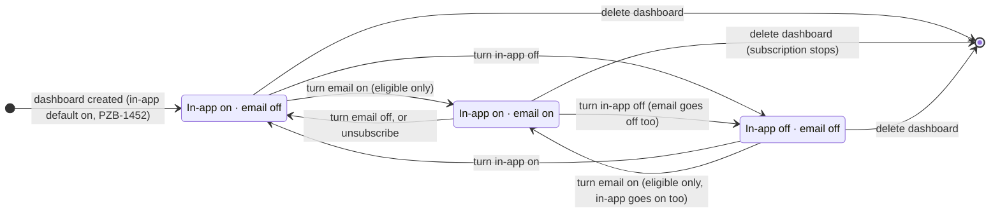

# ADR 0012: Storing email subscription status for dashboard alerts

- **Status:** Proposed
- **Date:** 2026-10-27
- **Updated:** 2026-10-29 (product feedback from AJ)

**Story:** PZB-1533 (email toggle), part of the email alerts MVP (PZB-1531).

**Scope:** how a dashboard's email subscription status is stored and changed, and what that storage must allow for the stories that read it (notify, unsubscribe, pipeline) and the one it builds on (PZB-1452, in-app monitoring). Sending, the unsubscribe flow and the pipeline are owned by other stories and are out of scope except where they constrain storage.

**Notation:** **(code)** = verified in the repositories; **(inferred)** = reasoning, not found in code; **(assumed, owner to confirm)** = a requirement from another story that its owner has not yet confirmed. Backend paths are under `project-zeno/`, frontend paths under `project-zeno-next/`.

## Context

What exists today (code):

- **Dashboards** live in the `dashboards` table (`project-zeno/src/api/data_models.py:549`): `id`, `user_id` → `users.id`, `name`, `description`, `is_public`, `created_at`, `updated_at`. There is no monitoring, alert or email column.
- **Each dashboard has exactly one area**, stored in `dashboard_aois` as `(source, src_id, subtype, name)` with no geometry. The API enforces one AOI on create (`project-zeno/src/api/schemas.py:738`).
- **In-app monitoring is not stored.** "Monitored" is derived on every request: the dashboard has an insight chart whose `dataset_id` is integrated alerts, and its area is a GADM admin area (`project-zeno/src/api/repositories/dashboard_writer.py:150-173`, `project-zeno/src/api/services/dashboard_alerts.py:81-84`). PZB-1452 has not been implemented in either repository.
- **Flag precedent:** `PATCH /api/dashboards/{id}/public` toggles `is_public` for the owner, an admin or a superuser; anyone else gets 404 (`project-zeno/src/api/routers/dashboards.py:311-334`, `_get_owned_dashboard` at `:140-148`, `_is_privileged` at `:88-92`).
- **`updated_at` has `onupdate=datetime.now`**, and the frontend shows it on dashboard cards ("Updated …") and the report page, sorts by it, and uses it to pick the latest dashboard for an area (`project-zeno-next/src/features/dashboards/ui/DashboardCard.tsx:79`, `ui/DashboardReportPage.tsx:232`, `lib/pagination.ts:71`, `model/find-dashboard-for-area.ts:54-60`).
- **Delete is a hard delete.** Areas, sections and widgets are removed by the ORM (`cascade="all, delete-orphan"`); the foreign keys have no `ON DELETE`.
- **The recipient address** is `users.email`, written only on first login (`project-zeno/src/api/auth/dependencies.py:130-151`), so it can drift from the Resource Watch account.
- **Nothing for sending exists yet:** no email provider, scheduler, sent-tracking or token signing. `itsdangerous==2.2.0` is a backend dependency but unused.
- **Weekly totals today are hectares** (`area_ha`) over the 7 days ending on the analytics service's latest integrated-alerts date.

## Decisions already made (PZB-1533)

1. **Only the dashboard owner can change email status, with no admin override.** Email is a personal consent; an admin cannot opt someone in. Status is one value per dashboard, not per viewer.
2. **Email status is returned only to the owner.** Viewers of a public dashboard don't see whether the owner receives email.
3. **Email starts off** on every dashboard (PZB-1533).
4. **The email switch is only allowed on eligible dashboards**: for now, an integrated-alerts chart and a GADM admin area, the same rule as the derived monitoring today (code: `supports_alerts`, `project-zeno/src/api/services/dashboard_alerts.py:81-84`). Product wants custom areas to qualify too, hopefully by the end of the sprint (open question 15). That would change the rule, not the storage, because the status is per dashboard whatever its area type (inferred).
5. **The coupling rule is enforced in the backend**, in one place, so the in-app toggle, the email toggle and the unsubscribe link all go through it.
6. **Store when and how email status last changed**: the time, and whether it came from the app or an unsubscribe link. No full history.
7. **Scope is email and in-app only.** No structure for other channels.
8. **How "already sent" is tracked is left to the pipeline owner.** Options are judged only on whether they have a natural place for a per-dashboard marker.
9. **Email requires in-app.** If in-app is off, email is off. If in-app is on, email can be on or off, and the two are controlled independently. Turning in-app off therefore turns email off, and turning email on while in-app is off turns in-app on too. Confirmed by AJ (product), 2026-10-29, on condition that the UI explains it clearly (open question 16).
10. **Deleting a dashboard stops its email subscription.** The status is deleted with the dashboard, and no further email is sent for it. Confirmed by AJ, 2026-10-29. The delete flow must make clear that the user loses both the dashboard and its email alerts (open question 16).

### Conditional decisions

- **C2 — A user's explicit in-app choice sticks; storage tells "never set" apart from "explicitly off".** Removing and re-adding the alerts chart does not reset in-app to on. **Must be confirmed by the PZB-1452 owner**, because it depends on whether the in-app default is stored when the dashboard is created or computed when read.

C1 (email requires in-app) was confirmed by AJ on 2026-10-29 and is now decision 9.

### Allowed states



There is no "in-app off · email on" state; in options A and B a database `CHECK` rules it out (decision 9). The starting state depends on PZB-1452's default (assumed on).

## Write path (proposed)

Everything in this section is a proposal for PZB-1533 (inferred), shaped after the existing `PATCH /api/dashboards/{id}/public` (code). It holds for options A, B and C unless a bullet says otherwise.

### Endpoint

`PATCH /api/dashboards/{dashboard_id}/email-alerts`, signed in (`require_auth`), with the body:

```json
{ "email_alerts_enabled": true }
```

This mirrors `PATCH …/public`, whose body is `{ "is_public": bool }` and whose response is the full dashboard (code: `DashboardPublicToggleRequest` and `DashboardPublicToggleResponse(DashboardResponse)`, `project-zeno/src/api/schemas.py:746`, `:1032`). The in-app header toggle belongs to PZB-1452 and is not designed here. The proposal only requires that both endpoints call the same backend function, which applies the coupling rule (decisions 5 and 9) and records the source (`'app'`).

### Response

The endpoint returns the updated dashboard, like `PATCH …/public`. Every dashboard response (detail, list, and the write responses) gains one field that is **present only when the viewer is the owner** (decision 2) and omitted otherwise:

```json
"alerts": {
  "in_app_enabled": true,
  "email_alerts_enabled": true,
  "email_alerts_changed_at": "2026-10-27T10:00:00",
  "email_alerts_changed_source": "app"
}
```

- `in_app_enabled` is the effective value. If PZB-1452 computes its default on read, a never-set switch is returned as `true`; the response does not expose "never set" (inferred).
- Public dashboards are readable by anyone (code: `get_dashboard`, `project-zeno/src/api/routers/dashboards.py:224-250`), so the owner check is on `row.user_id == user.id` when building the response, not on read access. `_expanded_response` already receives the viewer (code: `dashboards.py:159`).

### Behaviour and errors

| Case                                                                                                    | Result                                                                                                                                                                                                                                                                                                                                                                                         |
| ------------------------------------------------------------------------------------------------------- | ---------------------------------------------------------------------------------------------------------------------------------------------------------------------------------------------------------------------------------------------------------------------------------------------------------------------------------------------------------------------------------------------- |
| Not signed in                                                                                           | `401`, from `require_auth` (code).                                                                                                                                                                                                                                                                                                                                                             |
| Signed in but not the owner, **including admins and superusers**                                        | `404 "Dashboard not found"`, the same response as a missing dashboard, following the existing rule that not-found and not-owned are indistinguishable (code: `_get_owned_dashboard`, `dashboards.py:140-148`). The existing helper can't be reused as is, because it lets admins and superusers through (code: `_is_privileged`, `dashboards.py:88-92`); decision 1 needs an owner-only check. |
| Turning email **on** for an ineligible dashboard (no integrated-alerts chart, or not a GADM admin area) | `422` with a readable `detail`, the status the router already uses for domain validation (code: `dashboards.py:581-590`). Nothing is written.                                                                                                                                                                                                                                                  |
| Turning email **off**, eligible or not                                                                  | Always allowed, so an owner can clear the flag on a dashboard that stopped qualifying (inferred).                                                                                                                                                                                                                                                                                              |
| Turning email **on** while in-app is off                                                                | Both are turned on in one write. The response shows `in_app_enabled: true`, so the frontend updates the header toggle from the response, with no separate field or warning.                                                                                                                                                                                                                    |
| Turning email **off**                                                                                   | In-app is unchanged.                                                                                                                                                                                                                                                                                                                                                                           |
| Setting the value it already has                                                                        | `200` with the unchanged dashboard; `email_alerts_changed_at` and `_source` are **not** touched.                                                                                                                                                                                                                                                                                               |
| Turning in-app off (PZB-1452's endpoint)                                                                | Also turns email off, with source `'app'` (decision 9).                                                                                                                                                                                                                                                                                                                                        |

### What the pipeline can rely on

After any write through this path:

- **Email on** means the owner turned it on in the app while the dashboard was eligible, and in-app is on (decision 9; a database `CHECK` guarantees it in options A and B; in C only the backend function does).
- **Email on does not mean "still eligible".** Eligibility is checked only when email is turned on; the pipeline applies its own filter (see Consequences).
- **Email off** means one of: never turned on, turned off in the app, turned off because in-app was turned off (decision 9), or unsubscribed. `email_alerts_changed_source` tells `'app'` from `'unsubscribe'`; a never-set flag has no source and no time.
- **`email_alerts_changed_at` changes only when the value changes.** It uses the same timestamp convention as the existing dashboard columns: naive `DateTime`, `datetime.now` on the server (code: `project-zeno/src/api/data_models.py:562-567`).
- **A deleted dashboard has no status left** (decision 10; option A: deleted with the row; option B: by the cascade).
- **Writes don't change `dashboards.updated_at`.** In option A and C the write must set it to its current value (see the catch under Option A); option B never touches the row.

### How the option changes the write

- **A:** one `UPDATE dashboards …` that keeps `updated_at` as it is.
- **B:** an insert-or-update on `dashboard_alert_settings`, because the row may not exist yet.
- **C:** a `jsonb_set` on `alert_settings`; the coupling exists only in the backend function, with no database check.

## Dependencies and assumptions from other stories (owners to confirm)

- **PZB-1452 stores in-app monitoring as a user-controlled switch** (header toggle), on by default. The email coupling builds on it.
- **Unsubscribing turns email off for that one dashboard; in-app stays on** (PZB-1531).
- **Unsubscribing works without a sign-in, from one tamper-proof request, and only on POST, never GET**, so link scanners and previews can't trigger it.
- **An unsubscribe token is scoped to one dashboard, can only turn email off, doesn't expire, and old tokens keep working after re-subscribing.**
- **Unsubscribing a dashboard that no longer exists succeeds** and does nothing.
- **Alert emails are independent of `users.receive_news_emails`.**
- **No myGFW migration (PZB-1471) is assumed.**

## Decision drivers

1. The pipeline's "what to process" query is simple.
2. Per-dashboard unsubscribe without sign-in is tamper-safe.
3. There is a natural place for a per-dashboard "already sent" marker.
4. The email/in-app coupling is enforced in one place.
5. Deleting a dashboard cleans up its subscription.
6. Small migration from what exists today.

## Options

None of the options needs to store an unsubscribe token: each one can turn email off from a dashboard id alone, so the token design is left to the unsubscribe story (see open question 14).

### Option A — Columns on `dashboards`

Add to `dashboards`:

- `email_alerts_enabled boolean NOT NULL DEFAULT false`
- `email_alerts_changed_at timestamp NULL` and `email_alerts_changed_source text NULL` (`'app' | 'unsubscribe'`)
- In-app lives on the same row (PZB-1452's column), so the coupling can also be a database guard: `CHECK (NOT email_alerts_enabled OR <in-app is on>)` (decision 9).

| Driver         | Assessment                                                                                                        |
| -------------- | ----------------------------------------------------------------------------------------------------------------- |
| Pipeline query | Simplest: `dashboards JOIN users JOIN dashboard_aois WHERE email_alerts_enabled`, then the eligibility filter.    |
| Unsubscribe    | `UPDATE dashboards SET email_alerts_enabled = false … WHERE id = :id`; 0 rows when deleted, which still succeeds. |
| Sent marker    | A column on the same row if the pipeline owner wants one; widens `dashboards` further.                            |
| Coupling       | One service function plus an optional `CHECK` on one row.                                                         |
| Delete cleanup | Free: the status is deleted with the row.                                                                         |
| Migration      | One Alembic migration adding columns with server defaults; no backfill needed, because email starts off.          |

**Catch (code):** `updated_at` has `onupdate`, so a toggle or an unsubscribe would change the "Updated …" label and the sort order unless the write sets `updated_at` explicitly to its current value. Every writer (toggle, unsubscribe) must remember this (inferred).

**Fit by the answer to PZB-1452's default question (C2):**

- _Stored on creation:_ in-app is `NOT NULL DEFAULT true`. Telling "never set" from "explicitly off" needs an `in_app_changed_at` column (NULL = never set). Fits well.
- _Computed on read:_ in-app is a nullable boolean (NULL = never set, treated as on). The `CHECK` becomes `NOT email_alerts_enabled OR in_app IS NOT FALSE`. Still fits; the null rule must live in one helper.

### Option B — One-to-one `dashboard_alert_settings` table

A new table whose primary key `dashboard_id` references `dashboards.id ON DELETE CASCADE`, plus the ORM `cascade="all, delete-orphan"` the other children use. Columns: `in_app_enabled`, `email_enabled boolean NOT NULL DEFAULT false`, `email_changed_at`, `email_changed_source`, and the same `CHECK` (decision 9). This requires PZB-1452 to put its in-app switch in this table too.

| Driver         | Assessment                                                                                                                       |
| -------------- | -------------------------------------------------------------------------------------------------------------------------------- |
| Pipeline query | One more join: `dashboard_alert_settings JOIN dashboards JOIN users JOIN dashboard_aois WHERE email_enabled`.                    |
| Unsubscribe    | `UPDATE dashboard_alert_settings … WHERE dashboard_id = :id`; 0 rows when deleted, which still succeeds.                         |
| Sent marker    | Natural: a column on this row, kept out of `dashboards`.                                                                         |
| Coupling       | Same as A: one service function plus the row `CHECK`.                                                                            |
| Delete cleanup | Needs the cascade. Without it, dashboard deletes fail on the foreign key (code: no existing dashboard child FK has `ON DELETE`). |
| Migration      | New table, ORM model and relationship, and a create-or-update write path (insert on the first toggle, or on dashboard creation). |

Writes don't touch `dashboards.updated_at`, so toggling or unsubscribing doesn't change the "Updated …" label or reorder the dashboard list.

**Fit by the answer to PZB-1452's default question (C2):**

- _Computed on read:_ the best fit of all options. No row = never set (default on); rows appear only on the first explicit choice.
- _Stored on creation:_ a row is created with every dashboard, plus a backfill for existing dashboards. The "no row" advantage disappears and B becomes Option A in a separate table.

### Option C — JSONB `alert_settings` column on `dashboards`

`alert_settings jsonb NOT NULL DEFAULT '{}'` holding `{in_app, email, email_changed_at, email_changed_source}`.

| Driver         | Assessment                                                                                                               |
| -------------- | ------------------------------------------------------------------------------------------------------------------------ |
| Pipeline query | `WHERE (alert_settings->>'email')::boolean`; needs an expression index to stay cheap and is easy to get wrong elsewhere. |
| Unsubscribe    | A `jsonb_set` update; works.                                                                                             |
| Sent marker    | Easy to add a key; nothing checks its type.                                                                              |
| Coupling       | Only in application code; a `CHECK` on JSON paths is possible but awkward.                                               |
| Delete cleanup | Free.                                                                                                                    |
| Migration      | One column, and no schema change for later keys.                                                                         |

Same `updated_at` catch as A.

**Fit by the answer to PZB-1452's default question (C2):** a missing key naturally means "never set", which suits computed-on-read; stored-on-creation works too. Either way C trades typing and constraints for skipping future migrations, and with no new channels in scope that flexibility isn't needed (inferred).

## Recommendation

**Option A, columns on `dashboards`, provided PZB-1452 also puts its in-app switch on `dashboards`.** It gives the simplest pipeline query, cleanup on delete for free, a single-row `CHECK` for the coupling, and the smallest migration. The `updated_at` catch is real but local: the toggle and unsubscribe writes must preserve `updated_at`, and a test should cover it.

**Switch to Option B if** PZB-1452 puts in-app in a separate table, **or** computes the in-app default on read, **or** the pipeline owner needs more than one per-dashboard sent marker. In each case B's "no row = never set" and its separate home for alert state outweigh the extra join and the cascade.

**Option C is not recommended:** it moves the coupling out of the database and makes the pipeline query depend on JSON paths.

## Consequences

- **Owner-only reads and writes:** the dashboard response includes email and in-app status only for the owner, and the toggle endpoint rejects admins acting on others' dashboards, unlike `PATCH /public`.
- **One backend function sets in-app and email together** and applies the coupling. The toggle endpoint and the unsubscribe endpoint both call it, passing their source (`'app'` or `'unsubscribe'`).
- **Unsubscribe needs a signing secret** in backend config. Rotating it invalidates all links already sent.
- **Eligibility is checked when email is turned on, not kept in sync.** A dashboard that later loses its alerts chart keeps email on; the pipeline must apply the eligibility filter (pipeline owner to confirm).
- **The UI must explain two side effects** (AJ): turning in-app off stops email, and deleting a dashboard stops its email alerts (open question 16).
- **Risk, stale recipient:** `users.email` is written on first login only, so alerts can go to an old address after the user changes it in Resource Watch.
- **Risk, hectares vs counts:** the backend computes hectares today, while PZB-1452 and PZB-1531 specify alert counts. This doesn't change storage but does change what the pipeline computes.
- **myGFW migration:** A and B both tie a subscription to a dashboard. If PZB-1471 brings over subscriptions that have no dashboard, each would first need a dashboard, or a different table. Neither option makes that harder than the other (inferred).

## Open questions

### Could change the recommendation (answer before implementation)

1. **PZB-1452 owner: where does the in-app switch live?** On `dashboards` (favours A) or in a separate table (favours B)?
2. **PZB-1452 owner: is the in-app default stored on creation or computed on read?** This decides the shape of C2, and computed-on-read favours B.
3. ~~**AJ (product): does turning in-app off also turn email off (C1)?**~~ **Resolved 2026-10-29:** yes, see decision 9.
4. **Pipeline owner: what is the dedup key, and is it one marker per dashboard?** PZB-1452 counts alerts by the date they were added to GNW, not the alert date, so dedup likely follows the same rule. If the pipeline needs more than one marker per dashboard, prefer B or a pipeline-owned table.
5. **Pipeline owner: does the pipeline run in project-zeno or as a separate service reading the same database?** A separate service reads the schema directly, which favours plain columns (A or B) over JSON (C).

### Can go to owners asynchronously

6. **Pipeline owner:** skip dashboards that stopped qualifying while keeping their flag?
7. **Pipeline owner:** send to `users.email` even though it can be stale?
8. **Pipeline owner:** re-check email status right before each send, for unsubscribes made during a run?
9. **Pipeline owner:** send RFC 8058 one-click unsubscribe headers? Depends on the provider chosen in the PZB-1532 spike.
10. **Product and pipeline owner:** hectares or alert counts?
11. **Product:** one email per dashboard, or a digest per user? (Decided at refinement.)
12. **Product:** on ineligible dashboards, hide the toggle or show it disabled with an explanation?
13. **Product:** is the myGFW migration (PZB-1471) happening, and in what shape?
14. **Unsubscribe story owner:** confirm the assumed token rules: one dashboard, turns email off only, no expiry, POST only, and succeeds for deleted dashboards. Suggestion, not a decision: a signed, non-expiring token (`itsdangerous.URLSafeSerializer` with a dedicated salt, payload = dashboard id). It needs no storage, the HMAC prevents tampering, and since it can only turn email off, not being able to revoke it is acceptable (inferred). Rotating the signing secret would invalidate every link already sent (inferred). `itsdangerous==2.2.0` is already a backend dependency but unused (code).
15. **jterry64 (per AJ):** will custom areas be eligible by the end of the sprint? If so, only the eligibility rule changes (`supports_alerts`, code), not the storage (inferred).
16. **Product and design:** how do the in-app toggle and the delete dialog explain that turning in-app off stops email, and that deleting a dashboard stops its email alerts?
