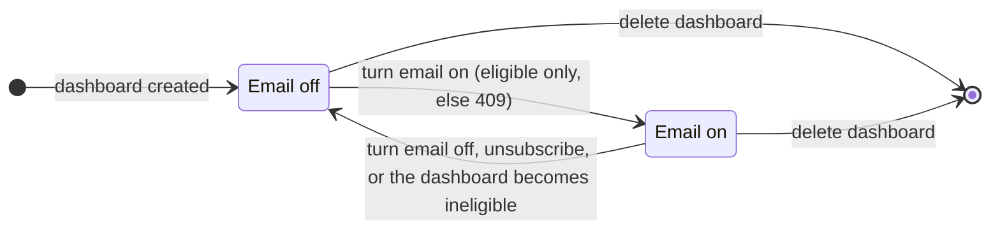
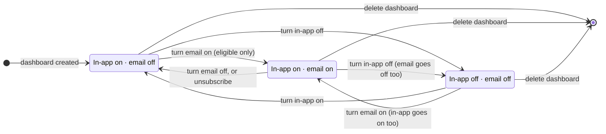

# ADR 0012: Storing email subscription status for dashboard alerts

- **Status:** Proposed (used as the base for implementing PZB-1533)
- **Date:** 2026-10-27
- **Updated:** 2026-10-29 (product feedback from AJ; review comments; project-zeno PR #885); 2026-11-03 (tech team: in-app opt-out per dashboard; Option D chosen); 2026-11-04 (F3: endpoint confirmed); 2026-11-05 (tech team, after Solomon's comment on project-zeno PR #890: in-app becomes the monitoring state, the `subscriptions` table holds email only, eligibility is stored; Justin: a dashboard that becomes ineligible loses its email subscription)
- **Implemented in:** project-zeno PR #890 (backend) and project-zeno-next PR #804 (frontend)

**Story:** PZB-1533 (email toggle), part of the email alerts MVP (PZB-1531).

**Scope:** how a dashboard's email subscription status is stored and changed, and what that storage must allow for the stories that read it (notify, unsubscribe, pipeline) and the one it builds on (PZB-1452, in-app monitoring). Sending, the unsubscribe flow and the pipeline are owned by other stories and are out of scope except where they constrain storage.

**Notation:** **(code)** = verified in the repositories; **(inferred)** = reasoning, not found in code; **(assumed, owner to confirm)** = a requirement from another story that its owner has not yet confirmed; **PR #885 (code)** = verified in project-zeno PR #885, merged as the start of the implementation. Backend paths are under `project-zeno/`, frontend paths under `project-zeno-next/`.

## Context

What exists today (code):

- **Dashboards** live in the `dashboards` table (`project-zeno/src/api/data_models.py:549`): `id`, `user_id` → `users.id`, `name`, `description`, `is_public`, `created_at`, `updated_at`. There is no monitoring, alert or email column.
- **Each dashboard has exactly one area**, stored in `dashboard_aois` as `(source, src_id, subtype, name)` with a `uuid` primary key and no geometry (`project-zeno/src/api/data_models.py:589-617`). The API enforces one AOI on create (`project-zeno/src/api/schemas.py:738`).
- **A dashboard's area never changes after creation:** AOIs are written only on create, and no endpoint updates them (`project-zeno/src/api/repositories/dashboard_writer.py:91-126`).
- **In-app monitoring is not stored.** "Monitored" is derived on every request: the dashboard has an insight chart whose `dataset_id` is integrated alerts, and its area is a GADM admin area (`project-zeno/src/api/repositories/dashboard_writer.py:150-173`, `project-zeno/src/api/services/dashboard_alerts.py:81-84`). PZB-1452 has not been implemented in either repository.
- ~~**In-app opt-out per dashboard (decided 2026-11-03 by the tech team: Willian Viana, Justin, Gary, Solomon, Dan).**~~ **Superseded 2026-11-05 by decision 13.** In-app is on by default on eligible dashboards, and the owner can turn it off per dashboard. This reverses the earlier answer that in-app had no opt-out. It is stored as an `in-app` mode row in `subscriptions` (decision 12). Nothing stores it yet (PR #885 (code): `Subscription` has no mode, and no tables exist).
- **Flag precedent:** `PATCH /api/dashboards/{id}/public` toggles `is_public` for the owner, an admin or a superuser; anyone else gets 404 (`project-zeno/src/api/routers/dashboards.py:311-334`, `_get_owned_dashboard` at `:140-148`, `_is_privileged` at `:88-92`).
- **`updated_at` has `onupdate=datetime.now`**, and the frontend shows it on dashboard cards ("Updated …") and the report page, sorts by it, and uses it to pick the latest dashboard for an area (`project-zeno-next/src/features/dashboards/ui/DashboardCard.tsx:79`, `ui/DashboardReportPage.tsx:232`, `lib/pagination.ts:71`, `model/find-dashboard-for-area.ts:54-60`).
- **Widget datasets:** widgets have no `dataset_id` column. Insight widgets reach theirs through `insight_charts.dataset_id`; map and alerts widgets keep theirs in `config.dataset.dataset_id` (JSONB), which the widget PATCH can replace.
- **Delete is a hard delete.** Areas, sections and widgets are removed by the ORM (`cascade="all, delete-orphan"`); the foreign keys have no `ON DELETE`.
- **The recipient address** is `users.email`, written only on first login (`project-zeno/src/api/auth/dependencies.py:130-151`), so it can drift from the Resource Watch account.
- **Nothing for sending exists yet:** no email provider, scheduler, sent-tracking or token signing. `itsdangerous==2.2.0` is a backend dependency but unused.
- **Weekly totals today are hectares** (`area_ha`) over the 7 days ending on the analytics service's latest integrated-alerts date.
- **Subscriptions interface (PR #885):** a superuser-only `GET /api/admin/subscriptions` backed by a `SubscriptionRepository` whose only implementation returns an empty list. No subscription storage exists yet.

## Design change, 2026-11-05

After Solomon's comment on project-zeno PR #890 (2026-11-05, https://github.com/wri/project-zeno/pull/890#issuecomment-6659091109), the tech team (Willian Viana, Justin, Gary, Solomon, Dan) separated the two meanings of "in-app". In-app is the dashboard's default monitoring state, not a delivery channel or a subscription mode. The `subscriptions` table holds outbound channels, starting with email. The design is based on the comment but doesn't follow it strictly: it adds no `monitoring_enabled` flag, and this story has no in-app toggle (PZB-1452 owns monitoring). Email doesn't require in-app; it requires a stored eligibility flag on the dashboard. Decisions 13 to 19 record the change; the decisions they replace are marked superseded and kept for the record.

## Decisions already made (PZB-1533)

1. **Only the dashboard owner can change email status, with no admin override.** Email is a personal consent; an admin cannot opt someone in. Status is one value per dashboard, not per viewer.
2. **Email status is visible to the owner and to superusers.** Dashboard responses include it for the owner and for superusers; other viewers of a public dashboard, including admins, don't see it. Superusers can also list every active subscription, with the user's id and email, through `GET /api/admin/subscriptions` (PR #885 (code)). Changing it stays owner-only (decision 1).
3. **Email starts off** on every dashboard (PZB-1533).
4. **Superseded 2026-11-05 by decision 16.** ~~**The email switch is only allowed on eligible dashboards**~~: for now, an integrated-alerts chart and a GADM admin area, the same rule as the derived monitoring today (code: `supports_alerts`, `project-zeno/src/api/services/dashboard_alerts.py:81-84`). Product wants custom areas to qualify too, hopefully by the end of the sprint (follow-up F13). That would change the rule, not the storage, because the status is per dashboard whatever its area type (inferred).
5. **Superseded 2026-11-05 by decision 14.** ~~**The coupling rule is enforced in the backend**~~, in one place, so the email toggle, the unsubscribe link and the in-app opt-out all go through it.
6. **Store when and how email status last changed**: the time, and whether it came from the app or an unsubscribe link. No full history. The decision 12 schema has no field for it yet (F-d).
7. **Subscriptions are shaped per dataset and mode; the MVP stores one dataset.** The API and the subscription record are keyed by dataset (`integrated_alerts`) and mode (`email`; `in-app` was removed on 2026-11-05, decision 13), so more can be added later without changing the API (review comment; `Dataset` enum in PR #885 (code)). For now the API accepts only `integrated_alerts`.
8. **How "already sent" is tracked is left to the pipeline owner.** Options are judged only on whether they have a natural place for a per-dashboard marker.
9. **Superseded 2026-11-05 by decision 14.** ~~**Email requires in-app.**~~ If in-app is off, email is off. If in-app is on, email can be on or off, and the two are controlled independently. Turning in-app off therefore turns email off, and turning email on while in-app is off turns in-app on too. Confirmed by AJ (product), 2026-10-29, on condition that the UI explains it clearly (F11). In force now that in-app has an opt-out (decision 11). It also bears on a dashboard that stops being eligible (F1).
10. **Deleting a dashboard stops its email subscription.** The status is deleted with the dashboard, and no further email is sent for it. Confirmed by AJ, 2026-10-29. The delete flow must make clear that the user loses both the dashboard and its email alerts (F11).
11. **Superseded 2026-11-05 by decision 13.** ~~**In-app can be turned off per dashboard, and the choice sticks.**~~ In-app is on by default for eligible dashboards. Only the owner can turn it off (decision 1 applies by analogy, inferred). The choice is stored and isn't recomputed. Turning in-app off turns email off (decision 9). Decided by the tech team (Willian Viana, Justin, Gary, Solomon, Dan), 2026-11-03. Stored as an `in-app` mode row (decision 12).
12. **Subscriptions live in their own `subscriptions` table (Option D), one row per mode.** The dashboard concept may change, but the area of interest is stable. Keeping subscriptions in their own table, tied to the AOI, lets other parts change without migrating subscriptions. Fields: `dashboard_id: UUID`, `subscription_id: UUID`, `aoi_id: UUID`, `user_id: str`, `dataset: Dataset`, `mode: Enum["email", "in-app"]`. In-app and email are separate modes. Decided by the tech team, 2026-11-03. **The `in-app` mode is superseded 2026-11-05 by decisions 13 and 15: `mode` is `email` only.** The table and Option D stand.
13. **In-app is the dashboard's default monitoring state, not a delivery channel or a subscription mode.** This story has no user toggle for it. Decided by the tech team, 2026-11-05.
14. **Email does not require in-app, and the coupling rule is removed.** No write has an in-app guard. Decided by the tech team, 2026-11-05.
15. **The `subscriptions` table holds only email rows for now. A row means email is on; turning email off deletes it.** The unique key stays `(dashboard_id, dataset, mode)`. Decided by the tech team, 2026-11-05.
16. **Eligibility is stored: `dashboards.eligible_for_subscription`, NOT NULL DEFAULT false.** It is true when the dashboard has at least one integrated-alerts widget: an insight with an integrated-alerts chart, or a map or alerts widget whose dataset is integrated alerts (clarified by Willian Viana, 2026-11-06). All area types qualify: admin areas, protected areas, key biodiversity areas, indigenous lands, custom areas and concessions. The GADM-only rule was for an earlier delivery. Decided by the tech team, 2026-11-05.
17. **The backend recomputes eligibility when a dashboard is created or its widgets change:** a widget added or removed, a widget's dataset changed, a template section added, or a section removed with its widgets. The frontend never sets it. Deleting a dashboard needs no update. Decided by the tech team, 2026-11-05.
18. **A dashboard that becomes ineligible loses its email subscription.** The same recompute deletes the email row; the owner has to turn email on again if the widget comes back. Decided by Justin, 2026-11-05. Resolves F1.
19. **Eligibility is in every dashboard response.** It is shown to every viewer (inferred: the decision doesn't say who sees it). The frontend uses it to decide whether to show the email toggle. The backend checks it before saving a subscription: `409` when the dashboard is not eligible, and nothing is saved. Decided by the tech team, 2026-11-05.

### Conditional decisions

None left.

- C1 (email requires in-app) was confirmed by AJ on 2026-10-29 and is decision 9. Superseded 2026-11-05 by decision 14.
- C2 (a user's explicit in-app choice sticks) is decision 11. It was first resolved as "in-app has no opt-out" on 2026-11-03, and the tech team reversed that the same day. Superseded 2026-11-05 by decision 13.

### Allowed states



Email on while ineligible is never stored (decisions 18 and 19). In-app monitoring is not part of this state (decision 13).

<details>
<summary>Superseded 2026-11-05: the earlier three-state model (decisions 9 and 11)</summary>



In-app off with email on is never allowed (decision 9). What a dashboard that stops being eligible counts as is F1.

</details>

## Write path

PR #885 implements only the read side (next section). The endpoint, verb and body were confirmed on 2026-11-04 (F3). Other write-side items marked (inferred) are still proposals. Implemented in project-zeno PR #890 (backend) and project-zeno-next PR #804 (frontend).

### Endpoint

`PUT /api/dashboards/{dashboard_id}/subscriptions` (confirmed 2026-11-04, F3), signed in (`require_auth`). The body is the desired state for the listed datasets; an empty `modes` turns email off:

```json
{
  "datasets": ["integrated_alerts"],
  "modes": ["email"]
}
```

- Only `integrated_alerts` is accepted for now (decision 7), and only the `email` mode (decisions 13 and 15).
- The write checks eligibility (decision 19), then adds or deletes the email row (decision 15). The unsubscribe endpoint deletes the same row (inferred).

### Response

The endpoint returns the updated dashboard. Every dashboard response (detail, list, and the write responses) gains one field, keyed by dataset, that is **present only when the viewer is the owner or a superuser** (decision 2) and omitted otherwise (inferred):

```json
"alerts": {
  "integrated_alerts": {
    "modes": ["email"],
    "last_updated": "2026-10-27T10:00:00",
    "last_updated_source": "app"
  }
}
```

- `modes` is `["email"]` when email is on and `[]` when it is off.
- Every dashboard response also gains a top-level `eligible_for_subscription: bool`, for every viewer (decision 19).
- `last_updated_source` says how the last change was made: `'app'` when the owner changed it in the app, `'unsubscribe'` when it came from an unsubscribe link in an email (decision 6). It tells "the user turned it off" from "the user unsubscribed from an email". A never-set subscription has no time and no source. Where these are stored is F-d.
- Public dashboards are readable by anyone (code: `get_dashboard`, `project-zeno/src/api/routers/dashboards.py:224-250`), so the check is on the viewer being the owner or a superuser when building the response, not on read access. `_expanded_response` already receives the viewer (code: `dashboards.py:159`).

### Behaviour and errors

| Case                                                                                    | Result                                                                                                                                                                                                                                                                                                                                                                                         |
| --------------------------------------------------------------------------------------- | ---------------------------------------------------------------------------------------------------------------------------------------------------------------------------------------------------------------------------------------------------------------------------------------------------------------------------------------------------------------------------------------------- |
| Not signed in                                                                           | `401`, from `require_auth` (code).                                                                                                                                                                                                                                                                                                                                                             |
| Signed in but not the owner, **including admins and superusers**                        | `404 "Dashboard not found"`, the same response as a missing dashboard, following the existing rule that not-found and not-owned are indistinguishable (code: `_get_owned_dashboard`, `dashboards.py:140-148`). The existing helper can't be reused as is, because it lets admins and superusers through (code: `_is_privileged`, `dashboards.py:88-92`); decision 1 needs an owner-only check. |
| A dataset or mode other than `integrated_alerts` / `email`, including `in-app`          | `422`: invalid input. Nothing is written (inferred).                                                                                                                                                                                                                                                                                                                                           |
| Turning email **on** for a dashboard that is not eligible (no integrated-alerts widget) | `409` with a readable `detail`: the request conflicts with the dashboard's state, not its input (review comment). The router already returns 409 for a state conflict (code: duplicate insight widget, `dashboards.py:466`). Nothing is written (decision 19).                                                                                                                                 |
| Turning email **off**, eligible or not                                                  | Always allowed (inferred). The email row is deleted.                                                                                                                                                                                                                                                                                                                                           |
| The last integrated-alerts widget removed while email is on                             | The recompute sets `eligible_for_subscription` to false and deletes the email row (decision 18).                                                                                                                                                                                                                                                                                               |
| Setting the value it already has                                                        | `200` with the unchanged dashboard; `last_updated` and the source are **not** touched (inferred).                                                                                                                                                                                                                                                                                              |

### What the pipeline can rely on

After any write through this path:

- **Email on** means the owner turned it on in the app while the dashboard was eligible.
- **Email on means the dashboard is eligible now:** a dashboard that becomes ineligible loses its email row (decision 18).
- **Email off** means one of: never turned on, turned off in the app, unsubscribed, or the dashboard became ineligible. The source tells `'app'` from `'unsubscribe'` (F-d).
- **The changed time moves only when the value changes.** It uses the same timestamp convention as the existing dashboard columns: naive `DateTime`, `datetime.now` on the server (code: `project-zeno/src/api/data_models.py:562-567`).
- **A deleted dashboard has no subscription left:** the subscription rows are removed by the cascade (decision 10).
- **Subscription writes never touch `dashboards.updated_at`**, because subscriptions are a separate table. Eligibility writes must keep it too (see Consequences).

### How the write is stored

Insert the `email` row to turn email on, delete it to turn email off (decision 15). Unique key `(dashboard_id, dataset, mode)`.

## Subscriptions read by the pipeline (PR #885)

PR #885 adds the read side the pipeline uses (code, verified):

- `GET /api/admin/subscriptions`, superuser only (`require_superuser`), returns `list[Subscription]` from `SubscriptionRepository.list_active()` (`project-zeno/src/api/routers/admin.py:165-171`, `project-zeno/src/api/services/subscription.py`). Verified.
- `Subscription` fields: `subscription_id: UUID`, `dashboard_id: UUID`, `user_id: str`, `user_email: str`, `aoi_type` (`admin | protected_area | key_biodiversity_area | indigenous_land | custom`, plus `concession` from PR #890, F16), `aoi_id: str`, `dataset` (`integrated_alerts`). Verified.
- The only implementation, `EmptySubscriptionRepository`, returns `[]` (`project-zeno/src/api/repositories/subscription_repository.py`). Verified. PR #890 provides the real one that reads the `subscriptions` table (F2).
- The pipeline depends on this shape, not on the tables, so the storage is internal to the repository.
- `subscription_id`, `dashboard_id`, `user_id` and `dataset` come from the row; `user_email` from `users`; `aoi_id` and `aoi_type` are the area's own id and type, for every area type. The stored `aoi_id` is `dashboard_aois.id`.
- **"Active" means every email row** (decision 15). `list_active` needs no in-app or eligibility filter, because a dashboard that becomes ineligible loses its email row (decision 18).

## Dependencies and assumptions from other stories (owners to confirm)

- **PZB-1452 owns in-app monitoring**, including any monitoring on/off toggle later. This story stores no in-app state (decision 13).
- **Unsubscribing deletes the email row for that one dashboard** (PZB-1531).
- **Unsubscribing works without a sign-in, from one tamper-proof request, and only on POST, never GET**, so link scanners and previews can't trigger it.
- **An unsubscribe token is scoped to one dashboard, can only turn email off, doesn't expire, and old tokens keep working after re-subscribing.**
- **Unsubscribing a dashboard that no longer exists succeeds** and does nothing.
- **Alert emails are independent of `users.receive_news_emails`.**
- **No myGFW migration (PZB-1471) is assumed.**

## Decision drivers

1. The query behind `list_active` (the pipeline's "what to process") is simple.
2. Per-dashboard unsubscribe without sign-in is tamper-safe.
3. There is a natural place for a per-dashboard "already sent" marker.
4. The email/in-app coupling is enforced in one place. (Moot since 2026-11-05: the coupling is removed, decision 14.)
5. Deleting a dashboard cleans up its subscription.
6. Small migration from what exists today.

## Options

None of the options needs to store an unsubscribe token: each one can turn email off from a dashboard id alone, so the token design is left to the unsubscribe story (see F12). The options were compared on 2026-11-03, while in-app was still a mode; the "With the in-app opt-out" notes no longer apply (decision 13).

### Option A — Columns on `dashboards`

Add to `dashboards`:

- `email_alerts_enabled boolean NOT NULL DEFAULT false`
- `email_alerts_changed_at timestamp NULL` and `email_alerts_changed_source text NULL` (`'app' | 'unsubscribe'`)
- The repository exposes each row as a `Subscription` (the "table view" from the review comment), with a derived `subscription_id` (inferred).

| Driver              | Assessment                                                                                                        |
| ------------------- | ----------------------------------------------------------------------------------------------------------------- |
| `list_active` query | Simplest: `dashboards JOIN users JOIN dashboard_aois WHERE email_alerts_enabled`, then the eligibility filter.    |
| Unsubscribe         | `UPDATE dashboards SET email_alerts_enabled = false … WHERE id = :id`; 0 rows when deleted, which still succeeds. |
| Sent marker         | A column on the same row if the pipeline owner wants one; widens `dashboards` further.                            |
| Coupling            | One service function.                                                                                             |
| Delete cleanup      | Free: the status is deleted with the row.                                                                         |
| Migration           | One Alembic migration adding columns with server defaults; no backfill needed, because email starts off.          |

**Catch (code):** `updated_at` has `onupdate`, so a toggle or an unsubscribe would change the "Updated …" label and the sort order unless the write sets `updated_at` explicitly to its current value. Every writer (toggle, unsubscribe) must remember this (inferred).

**With the in-app opt-out:** one more column, `in_app_alerts_enabled`.

**Not chosen:** it ties subscriptions to the `dashboards` row, so a change to dashboards means migrating subscriptions. It also has no stored `subscription_id` and has the `updated_at` catch.

### Option B — One-to-one `dashboard_alert_settings` table

A new table whose primary key `dashboard_id` references `dashboards.id ON DELETE CASCADE`, plus the ORM `cascade="all, delete-orphan"` the other children use. Columns: `email_enabled boolean NOT NULL DEFAULT false`, `email_changed_at`, `email_changed_source`.

| Driver              | Assessment                                                                                                                       |
| ------------------- | -------------------------------------------------------------------------------------------------------------------------------- |
| `list_active` query | One more join: `dashboard_alert_settings JOIN dashboards JOIN users JOIN dashboard_aois WHERE email_enabled`.                    |
| Unsubscribe         | `UPDATE dashboard_alert_settings … WHERE dashboard_id = :id`; 0 rows when deleted, which still succeeds.                         |
| Sent marker         | Natural: a column on this row, kept out of `dashboards`.                                                                         |
| Coupling            | Same as A: one service function.                                                                                                 |
| Delete cleanup      | Needs the cascade. Without it, dashboard deletes fail on the foreign key (code: no existing dashboard child FK has `ON DELETE`). |
| Migration           | New table, ORM model and relationship, and a create-or-update write path (insert on the first toggle, or on dashboard creation). |

Writes don't touch `dashboards.updated_at`, so toggling or unsubscribing doesn't change the "Updated …" label or reorder the dashboard list.

**With the in-app opt-out:** one more column on the same row; no row means in-app on and email off.

**Not chosen:** it is keyed by dashboard and holds one dataset and channel, so a second dataset or mode needs a migration. It is still tied to the dashboard.

### Option C — JSONB `alert_settings` column on `dashboards`

`alert_settings jsonb NOT NULL DEFAULT '{}'` holding `{email, email_changed_at, email_changed_source}`.

| Driver              | Assessment                                                                                                                                                         |
| ------------------- | ------------------------------------------------------------------------------------------------------------------------------------------------------------------ |
| `list_active` query | `WHERE (alert_settings->>'email')::boolean`; needs an expression index to stay cheap. Now internal to the repository, since the pipeline reads PR #885's endpoint. |
| Unsubscribe         | A `jsonb_set` update; works.                                                                                                                                       |
| Sent marker         | Easy to add a key; nothing checks its type.                                                                                                                        |
| Coupling            | One service function, as in every option.                                                                                                                          |
| Delete cleanup      | Free.                                                                                                                                                              |
| Migration           | One column, and no schema change for later keys.                                                                                                                   |

Same `updated_at` catch as A.

**With the in-app opt-out:** one more key, `in_app`.

**Not chosen:** it is untyped and lives on the `dashboards` row, with the same tie and the same `updated_at` catch as A.

### Option D — `subscriptions` table (chosen)

The "subscriptions table" from the review comment. One row per dashboard, dataset and mode, with the schema from decision 12: `subscription_id` primary key, `dashboard_id` → `dashboards.id ON DELETE CASCADE` plus the ORM cascade, `aoi_id`, `user_id`, `dataset`, `mode` (`email` | `in-app`). The in-app opt-out is an `in-app` mode row.

| Driver              | Assessment                                                                                                                                 |
| ------------------- | ------------------------------------------------------------------------------------------------------------------------------------------ |
| `list_active` query | `subscriptions JOIN users WHERE mode = 'email'`, plus the in-app rule (F-e) and the eligibility filter (F1).                               |
| Unsubscribe         | Removes or turns off the `email` row for `(dashboard_id, dataset)`; nothing to change when the dashboard is deleted, which still succeeds. |
| Sent marker         | Natural: a column on the subscription row.                                                                                                 |
| Coupling            | One service function, as in every option.                                                                                                  |
| Delete cleanup      | Needs the cascade, like B.                                                                                                                 |
| Migration           | New table, ORM model and relationship, and an insert-or-delete write path.                                                                 |

Stores `subscription_id` and has room for more datasets and modes without a migration. Writes don't touch `dashboards.updated_at`.

## Decision

**Option D, a `subscriptions` table** (decision 12). One row per dashboard, dataset and mode: `subscription_id` PK, `dashboard_id` → `dashboards.id ON DELETE CASCADE` plus the ORM cascade, `aoi_id` UUID, `user_id`, `dataset`, `mode`. A new dataset or mode is a new row, not a migration. Since 2026-11-05 the table holds only email rows, and eligibility is a stored column on `dashboards` (decisions 13 to 19). Open point: F-d.

Reason (tech team, 2026-11-03): the dashboard concept may change, but the area of interest is stable, so keeping subscriptions in their own table, tied to the AOI, lets other parts change without migrating subscriptions.

## Consequences

- **Owner-only writes, owner and superuser reads:** dashboard responses include the status for the owner and superusers (decision 2); superusers can list all subscriptions; only the owner can change it, unlike `PATCH /public`.
- **One function recomputes eligibility** and deletes the email row when a dashboard becomes ineligible. Every dashboard write that creates a dashboard or adds, removes or changes widgets calls it, in the same transaction (decisions 17 and 18).
- **Eligibility is stored and kept current,** so the toggle, the 409 and `list_active` all read the same value.
- **Eligibility writes must not move `dashboards.updated_at`:** widget writes don't move it today, and it drives the "Updated …" label and the list order.
- **The pipeline contract is PR #885's `Subscription`**, with `concession` added to `aoi_type` (F16). `subscription_id` is stored, and sent markers go on the row.
- **New table, ORM model, relationship with `cascade="all, delete-orphan"`, and an FK with `ON DELETE CASCADE`.** Without the cascade, dashboard deletes fail (code: no existing child FK has `ON DELETE`).
- **No `updated_at` catch for subscription writes:** they don't touch `dashboards`.
- **Still tied to dashboards:** the required `dashboard_id` means subscriptions die with their dashboard (decision 10), and replacing the dashboard concept would still mean migrating that column. The stored `aoi_id` is `dashboard_aois.id`, which is per dashboard.
- **Change tracking:** none in the schema (F-d, against decision 6).
- **Unsubscribe needs a signing secret** in backend config. Rotating it invalidates all links already sent.
- **The UI must explain that deleting a dashboard stops its email alerts, and that removing the last integrated-alerts widget turns email off** (F11, F14).
- **Risk, two eligibility rules:** the in-app summary still uses `supports_alerts` (GADM admin area plus an insight chart), while email eligibility covers every area type and map and alerts widgets. They can disagree until PZB-1452 revisits it (F15).
- **Risk, stale recipient:** `users.email` is written on first login only, so alerts can go to an old address after the user changes it in Resource Watch.
- **Risk, hectares vs counts:** the backend computes hectares today, while PZB-1452 and PZB-1531 specify alert counts. This doesn't change storage but does change what the pipeline computes.
- **myGFW migration:** a required `dashboard_id` means a migrated subscription needs a dashboard first. Making it nullable later is a smaller change in D than in A or B (inferred).

## Resolved questions

1. ~~**PZB-1452 owner: where does the in-app switch live?**~~ **Resolved 2026-11-03:** as an `in-app` mode row in `subscriptions` (decisions 11 and 12). Superseded 2026-11-05: in-app is not stored (decision 13).
2. ~~**PZB-1452 owner: is the in-app default stored on creation or computed on read?**~~ **Resolved 2026-11-03:** in-app is on by default and the owner's opt-out is stored (decision 11). Superseded 2026-11-05 by decision 13.
3. ~~**AJ (product): does turning in-app off also turn email off (C1)?**~~ **Resolved 2026-10-29:** yes, see decision 9. Superseded 2026-11-05 by decision 14.
4. ~~**Pipeline owner: does the pipeline run in project-zeno or as a separate service reading the same database?**~~ **Resolved by PR #885:** it reads `GET /api/admin/subscriptions` (superuser only), not the tables.
5. ~~**jterry64: must `subscription_id` be stored?**~~ **Resolved 2026-11-03:** yes, Option D stores it.
6. ~~**PZB-1452 owner and jterry64: should in-app become a contact type?**~~ **Resolved 2026-11-03:** in-app is a mode (decision 12). Superseded 2026-11-05: in-app is not a mode (decision 13).
7. ~~**Pipeline owner: what is the dedup key, and is it one marker per dashboard?**~~ **Resolved during Coffee + code:** the pipeline will have `aoi_id`, `dashboard_id` and `subscription_id`. Sent markers, if any, go on the subscription row.
8. ~~**F3, jterry64: endpoint path, verb and body (`modes`).**~~ **Resolved 2026-11-04:** `PUT /api/dashboards/{dashboard_id}/subscriptions` with `{"datasets": [...], "modes": [...]}` as the desired state.
9. ~~**F-a, mode:**~~ **Resolved 2026-11-05:** `list_active` returns email rows only, so `Subscription` needs no `mode` (decision 15).
10. ~~**F-b, `aoi_id`:**~~ **Resolved in project-zeno PR #890:** the stored `aoi_id` is `dashboard_aois.id`; the pipeline gets the area's own id and type.
11. ~~**F-c, `user_email`:**~~ **Resolved in project-zeno PR #890:** joined from `users`.
12. ~~**F-e, what a row means:**~~ **Resolved 2026-11-05:** a row means email is on; turning it off deletes the row (decision 15).
13. ~~**F1, a dashboard with email on stops qualifying:**~~ **Resolved by Justin, 2026-11-05:** the recompute deletes the email row; the owner turns email on again if the widget comes back (decision 18).
14. ~~**F2, build the storage and the real `SubscriptionRepository`:**~~ **Done in project-zeno PR #890.**
15. ~~**F9, hide or disable the toggle on ineligible dashboards:**~~ **Resolved 2026-11-05:** hidden when `eligible_for_subscription` is false (decision 19).
16. ~~**F13, will custom areas be eligible:**~~ **Resolved 2026-11-05:** custom areas, and every other area type, qualify (decision 16).

## Follow-ups

| #   | Item                                                                                                                                                                                                                                                                                                                                               | Owner                   |
| --- | -------------------------------------------------------------------------------------------------------------------------------------------------------------------------------------------------------------------------------------------------------------------------------------------------------------------------------------------------- | ----------------------- |
| F-d | **Change tracking:** the schema has no `last_updated` / `last_updated_source`, which decision 6 requires. Add them, or drop decision 6? Since a row means email is on (decision 15), turning email off deletes the row, so the time and source of that change have nowhere to live in this table.                                                  | Tech team               |
| F4  | (was Q7) Send to `users.email` even though it can be stale?                                                                                                                                                                                                                                                                                        | Pipeline owner          |
| F5  | (was Q8) Re-check email status right before each send, for unsubscribes made during a run?                                                                                                                                                                                                                                                         | Pipeline owner          |
| F6  | (was Q9) Send RFC 8058 one-click unsubscribe headers? Depends on the provider chosen in the PZB-1532 spike.                                                                                                                                                                                                                                        | Pipeline owner          |
| F7  | (was Q10) Hectares or alert counts?                                                                                                                                                                                                                                                                                                                | Product, pipeline owner |
| F8  | (was Q11) One email per dashboard, or a digest per user? (Decided at refinement.)                                                                                                                                                                                                                                                                  | Product                 |
| F10 | (was Q13) Is the myGFW migration (PZB-1471) happening, and in what shape?                                                                                                                                                                                                                                                                          | Product                 |
| F11 | (was Q16) Copy for the delete dialog ("deleting stops email alerts"). The copy for turning in-app off is no longer needed (decision 13).                                                                                                                                                                                                           | Product, design         |
| F12 | (was Q14) Confirm the assumed token rules: one dashboard, turns email off only, no expiry, POST only, succeeds for deleted dashboards. Suggestion, not a decision: a signed, non-expiring token (`itsdangerous.URLSafeSerializer` with a dedicated salt, payload = dashboard id); `itsdangerous==2.2.0` is already a dependency but unused (code). | Unsubscribe story owner |
| F14 | Copy and placement of the message telling the owner that removing the last integrated-alerts widget turns email off (decision 18): a warning before removal (the widget remove action and the section delete dialog), or a notice after. project-zeno-next PR #804 ships a notice after, with placeholder copy.                                    | Product, design         |
| F15 | The in-app weekly summary and badge still use the derived rule (`supports_alerts`: a GADM admin area plus an insight chart). Align it with `eligible_for_subscription`, or keep them separate on purpose?                                                                                                                                          | PZB-1452 owner          |
| F16 | The `Subscription.aoi_type` contract gains `concession` (oil palm, RSPO oil palm, logging, mining and wood fiber areas), since all area types qualify (decision 16).                                                                                                                                                                               | Pipeline owner          |
