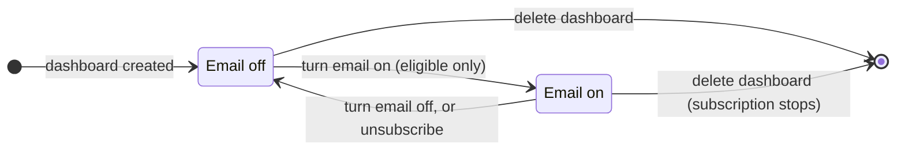

# ADR 0012: Storing email subscription status for dashboard alerts

- **Status:** Proposed
- **Date:** 2026-10-27
- **Updated:** 2026-10-29 (product feedback from AJ; review comments; project-zeno PR #885); 2026-11-03 (in-app has no opt-out)

**Story:** PZB-1533 (email toggle), part of the email alerts MVP (PZB-1531).

**Scope:** how a dashboard's email subscription status is stored and changed, and what that storage must allow for the stories that read it (notify, unsubscribe, pipeline) and the one it builds on (PZB-1452, in-app monitoring). Sending, the unsubscribe flow and the pipeline are owned by other stories and are out of scope except where they constrain storage.

**Notation:** **(code)** = verified in the repositories; **(inferred)** = reasoning, not found in code; **(assumed, owner to confirm)** = a requirement from another story that its owner has not yet confirmed; **PR #885 (code)** = verified in project-zeno PR #885, merged as the start of the implementation. Backend paths are under `project-zeno/`, frontend paths under `project-zeno-next/`.

## Context

What exists today (code):

- **Dashboards** live in the `dashboards` table (`project-zeno/src/api/data_models.py:549`): `id`, `user_id` → `users.id`, `name`, `description`, `is_public`, `created_at`, `updated_at`. There is no monitoring, alert or email column.
- **Each dashboard has exactly one area**, stored in `dashboard_aois` as `(source, src_id, subtype, name)` with no geometry. The API enforces one AOI on create (`project-zeno/src/api/schemas.py:738`).
- **In-app monitoring is not stored.** "Monitored" is derived on every request: the dashboard has an insight chart whose `dataset_id` is integrated alerts, and its area is a GADM admin area (`project-zeno/src/api/repositories/dashboard_writer.py:150-173`, `project-zeno/src/api/services/dashboard_alerts.py:81-84`). PZB-1452 has not been implemented in either repository.
- **In-app has no opt-out.** Every user sees in-app notifications on eligible dashboards, and nothing about in-app is stored: its default is neither stored on creation nor computed from a stored value (answered 2026-11-03, relayed by the driver).
- **Flag precedent:** `PATCH /api/dashboards/{id}/public` toggles `is_public` for the owner, an admin or a superuser; anyone else gets 404 (`project-zeno/src/api/routers/dashboards.py:311-334`, `_get_owned_dashboard` at `:140-148`, `_is_privileged` at `:88-92`).
- **`updated_at` has `onupdate=datetime.now`**, and the frontend shows it on dashboard cards ("Updated …") and the report page, sorts by it, and uses it to pick the latest dashboard for an area (`project-zeno-next/src/features/dashboards/ui/DashboardCard.tsx:79`, `ui/DashboardReportPage.tsx:232`, `lib/pagination.ts:71`, `model/find-dashboard-for-area.ts:54-60`).
- **Delete is a hard delete.** Areas, sections and widgets are removed by the ORM (`cascade="all, delete-orphan"`); the foreign keys have no `ON DELETE`.
- **The recipient address** is `users.email`, written only on first login (`project-zeno/src/api/auth/dependencies.py:130-151`), so it can drift from the Resource Watch account.
- **Nothing for sending exists yet:** no email provider, scheduler, sent-tracking or token signing. `itsdangerous==2.2.0` is a backend dependency but unused.
- **Weekly totals today are hectares** (`area_ha`) over the 7 days ending on the analytics service's latest integrated-alerts date.
- **Subscriptions interface (PR #885):** a superuser-only `GET /api/admin/subscriptions` backed by a `SubscriptionRepository` whose only implementation returns an empty list. No subscription storage exists yet.

## Decisions already made (PZB-1533)

1. **Only the dashboard owner can change email status, with no admin override.** Email is a personal consent; an admin cannot opt someone in. Status is one value per dashboard, not per viewer.
2. **Email status is visible to the owner and to superusers.** Dashboard responses include it for the owner and for superusers; other viewers of a public dashboard, including admins, don't see it. Superusers can also list every active subscription, with the user's id and email, through `GET /api/admin/subscriptions` (PR #885 (code)). Changing it stays owner-only (decision 1).
3. **Email starts off** on every dashboard (PZB-1533).
4. **The email switch is only allowed on eligible dashboards**: for now, an integrated-alerts chart and a GADM admin area, the same rule as the derived monitoring today (code: `supports_alerts`, `project-zeno/src/api/services/dashboard_alerts.py:81-84`). Product wants custom areas to qualify too, hopefully by the end of the sprint (open question 15). That would change the rule, not the storage, because the status is per dashboard whatever its area type (inferred).
5. **The coupling rule is enforced in the backend**, in one place, so the email toggle, the unsubscribe link and any future in-app opt-out all go through it.
6. **Store when and how email status last changed**: the time, and whether it came from the app or an unsubscribe link. No full history.
7. **Subscriptions are shaped per dataset and contact type; the MVP stores one.** The API and the subscription record are keyed by dataset (`integrated_alerts`) and contact type (`email`), so more can be added later without changing the API (review comment; `Dataset` enum in PR #885 (code)). For now the API accepts only `integrated_alerts` and `email`, and storage holds only that combination.
8. **How "already sent" is tracked is left to the pipeline owner.** Options are judged only on whether they have a natural place for a per-dashboard marker.
9. **Email requires in-app.** If in-app is off, email is off. If in-app is on, email can be on or off, and the two are controlled independently. Turning in-app off therefore turns email off, and turning email on while in-app is off turns in-app on too. Confirmed by AJ (product), 2026-10-29, on condition that the UI explains it clearly (open question 16). Today no user action turns in-app off, because in-app has no opt-out; the rule takes effect once one exists. It also bears on a dashboard that stops being eligible (open question 6).
10. **Deleting a dashboard stops its email subscription.** The status is deleted with the dashboard, and no further email is sent for it. Confirmed by AJ, 2026-10-29. The delete flow must make clear that the user loses both the dashboard and its email alerts (open question 16).

### Conditional decisions

None left.

- C1 (email requires in-app) was confirmed by AJ on 2026-10-29 and is now decision 9.
- ~~**C2 — A user's explicit in-app choice sticks.**~~ **Resolved 2026-11-03:** there is no in-app choice to store. In-app is on for every user with no opt-out, and stays derived from the dashboard. If an opt-out is added later, C2 comes back with it.

### Allowed states



In-app is always on today (no opt-out), so these are the only states. If an in-app opt-out is added, decision 9 adds an "in-app off · email off" state that turning in-app off leads to. Whether a dashboard that stops being eligible counts as in-app off is open question 6.

## Write path (proposed)

Everything in this section is a proposal for PZB-1533 (inferred), following the review comment to make it a general subscribe endpoint. It holds for every option unless a bullet says otherwise.

### Endpoint

`PUT /api/dashboards/{dashboard_id}/subscriptions` (path and verb inferred), signed in (`require_auth`). The body is the desired state for the listed datasets; an empty `contact_types` turns them off:

```json
{
  "datasets": ["integrated_alerts"],
  "contact_types": ["email"]
}
```

Only `integrated_alerts` and `email` are accepted for now (decision 7). It calls the backend function that applies the coupling rule (decisions 5 and 9) and records how the change was made; the unsubscribe endpoint calls the same function.

### Response

The endpoint returns the updated dashboard. Every dashboard response (detail, list, and the write responses) gains one field, keyed by dataset, that is **present only when the viewer is the owner or a superuser** (decision 2) and omitted otherwise:

```json
"alerts": {
  "in_app_enabled": true,
  "integrated_alerts": {
    "contact_types": ["email"],
    "last_updated": "2026-10-27T10:00:00",
    "last_updated_source": "app"
  }
}
```

- `last_updated_source` says how the last change was made: `'app'` when the owner changed it in the app, `'unsubscribe'` when it came from an unsubscribe link in an email (decision 6). It tells "the user turned it off" from "the user unsubscribed from an email". A never-set subscription has no time and no source.
- `in_app_enabled` is read-only and derived: with no in-app opt-out, it is `true` whenever the dashboard is eligible (inferred). It stays outside the dataset key; whether in-app becomes a contact type is open question 18.
- Public dashboards are readable by anyone (code: `get_dashboard`, `project-zeno/src/api/routers/dashboards.py:224-250`), so the check is on the viewer being the owner or a superuser when building the response, not on read access. `_expanded_response` already receives the viewer (code: `dashboards.py:159`).

### Behaviour and errors

| Case                                                                                                    | Result                                                                                                                                                                                                                                                                                                                                                                                         |
| ------------------------------------------------------------------------------------------------------- | ---------------------------------------------------------------------------------------------------------------------------------------------------------------------------------------------------------------------------------------------------------------------------------------------------------------------------------------------------------------------------------------------- |
| Not signed in                                                                                           | `401`, from `require_auth` (code).                                                                                                                                                                                                                                                                                                                                                             |
| Signed in but not the owner, **including admins and superusers**                                        | `404 "Dashboard not found"`, the same response as a missing dashboard, following the existing rule that not-found and not-owned are indistinguishable (code: `_get_owned_dashboard`, `dashboards.py:140-148`). The existing helper can't be reused as is, because it lets admins and superusers through (code: `_is_privileged`, `dashboards.py:88-92`); decision 1 needs an owner-only check. |
| A dataset or contact type other than `integrated_alerts` / `email`                                      | `422`: invalid input. Nothing is written.                                                                                                                                                                                                                                                                                                                                                      |
| Turning email **on** for an ineligible dashboard (no integrated-alerts chart, or not a GADM admin area) | `409` with a readable `detail`: the request conflicts with the dashboard's state, not its input (review comment). The router already returns 409 for a state conflict (code: duplicate insight widget, `dashboards.py:466`). Nothing is written.                                                                                                                                               |
| Turning email **off** (`contact_types: []`), eligible or not                                            | Always allowed, so an owner can clear it on a dashboard that stopped qualifying (inferred).                                                                                                                                                                                                                                                                                                    |
| Turning email **off**                                                                                   | In-app is unchanged.                                                                                                                                                                                                                                                                                                                                                                           |
| Setting the value it already has                                                                        | `200` with the unchanged dashboard; `last_updated` and the source are **not** touched.                                                                                                                                                                                                                                                                                                         |

### What the pipeline can rely on

After any write through this path:

- **Email on** means the owner turned it on in the app while the dashboard was eligible.
- **Whether email on still means eligible is open question 6:** either the flag stays and `list_active` filters on eligibility, or removing the alerts chart turns email off.
- **Email off** means one of: never turned on, turned off in the app, or unsubscribed. The source tells `'app'` from `'unsubscribe'`.
- **The changed time moves only when the value changes.** It uses the same timestamp convention as the existing dashboard columns: naive `DateTime`, `datetime.now` on the server (code: `project-zeno/src/api/data_models.py:562-567`).
- **A deleted dashboard has no subscription left** (decision 10; options A and C: deleted with the row; B and D: by the cascade).
- **Writes don't change `dashboards.updated_at`.** In options A and C the write must set it to its current value (see the catch under Option A); B and D never touch the row.

### How the option changes the write

- **A:** one `UPDATE dashboards …` that keeps `updated_at` as it is.
- **B:** an insert-or-update on `dashboard_alert_settings`, because the row may not exist yet.
- **C:** a `jsonb_set` on `alert_settings`.
- **D:** an insert-or-update on `subscriptions`, keyed by dashboard and dataset.

## Subscriptions read by the pipeline (PR #885)

PR #885 adds the read side the pipeline uses (code):

- `GET /api/admin/subscriptions`, superuser only (`require_superuser`), returns `list[Subscription]` from `SubscriptionRepository.list_active()` (`project-zeno/src/api/routers/admin.py:165-171`, `project-zeno/src/api/services/subscription.py`).
- `Subscription` fields: `subscription_id: UUID`, `dashboard_id: UUID`, `user_id: str`, `user_email: str`, `aoi_type` (`admin | protected_area | key_biodiversity_area | indigenous_land | custom`), `aoi_id: str`, `dataset` (`integrated_alerts`).
- The only implementation, `EmptySubscriptionRepository`, returns `[]` (`project-zeno/src/api/repositories/subscription_repository.py`). PZB-1533 provides the real one that reads the storage chosen here.
- The pipeline depends on this shape, not on the tables, so the storage option is internal to the repository. The repository maps `dashboard_aois` to the pipeline's names (`gadm` → `admin`, `src_id` → `aoi_id`) and fills `user_email` from `users.email` (inferred). In option A, `subscription_id` has no column, so it is derived from the dashboard id and dataset (inferred; open question 17).
- PR #885 doesn't define what "active" means. Under this ADR it is at least email on; whether it also filters eligibility is open question 6.

## Dependencies and assumptions from other stories (owners to confirm)

- ~~**PZB-1452 stores in-app monitoring as a user-controlled switch.**~~ **Answered 2026-11-03:** in-app has no opt-out and isn't stored; it is on for every user on eligible dashboards. The email switch is the only stored alert setting.
- **Unsubscribing turns email off for that one dashboard; in-app stays on** (PZB-1531).
- **Unsubscribing works without a sign-in, from one tamper-proof request, and only on POST, never GET**, so link scanners and previews can't trigger it.
- **An unsubscribe token is scoped to one dashboard, can only turn email off, doesn't expire, and old tokens keep working after re-subscribing.**
- **Unsubscribing a dashboard that no longer exists succeeds** and does nothing.
- **Alert emails are independent of `users.receive_news_emails`.**
- **No myGFW migration (PZB-1471) is assumed.**

## Decision drivers

1. The query behind `list_active` (the pipeline's "what to process") is simple.
2. Per-dashboard unsubscribe without sign-in is tamper-safe.
3. There is a natural place for a per-dashboard "already sent" marker.
4. The email/in-app coupling is enforced in one place.
5. Deleting a dashboard cleans up its subscription.
6. Small migration from what exists today.

## Options

None of the options needs to store an unsubscribe token: each one can turn email off from a dashboard id alone, so the token design is left to the unsubscribe story (see open question 14).

### Option A — Columns on `dashboards`

Add to `dashboards`:

- `email_alerts_enabled boolean NOT NULL DEFAULT false`
- `email_alerts_changed_at timestamp NULL` and `email_alerts_changed_source text NULL` (`'app' | 'unsubscribe'`)
- The repository exposes each row as a `Subscription` (the "table view" from the review comment), with a derived `subscription_id` (inferred).

| Driver              | Assessment                                                                                                        |
| ------------------- | ----------------------------------------------------------------------------------------------------------------- |
| `list_active` query | Simplest: `dashboards JOIN users JOIN dashboard_aois WHERE email_alerts_enabled`, then the eligibility filter.    |
| Unsubscribe         | `UPDATE dashboards SET email_alerts_enabled = false … WHERE id = :id`; 0 rows when deleted, which still succeeds. |
| Sent marker         | A column on the same row if the pipeline owner wants one; widens `dashboards` further.                            |
| Coupling            | One service function; no `CHECK`, because in-app isn't stored.                                                    |
| Delete cleanup      | Free: the status is deleted with the row.                                                                         |
| Migration           | One Alembic migration adding columns with server defaults; no backfill needed, because email starts off.          |

**Catch (code):** `updated_at` has `onupdate`, so a toggle or an unsubscribe would change the "Updated …" label and the sort order unless the write sets `updated_at` explicitly to its current value. Every writer (toggle, unsubscribe) must remember this (inferred).

**Fit with in-app (C2, resolved):** in-app isn't stored, so A holds only the email columns.

### Option B — One-to-one `dashboard_alert_settings` table

A new table whose primary key `dashboard_id` references `dashboards.id ON DELETE CASCADE`, plus the ORM `cascade="all, delete-orphan"` the other children use. Columns: `email_enabled boolean NOT NULL DEFAULT false`, `email_changed_at`, `email_changed_source`.

| Driver              | Assessment                                                                                                                       |
| ------------------- | -------------------------------------------------------------------------------------------------------------------------------- |
| `list_active` query | One more join: `dashboard_alert_settings JOIN dashboards JOIN users JOIN dashboard_aois WHERE email_enabled`.                    |
| Unsubscribe         | `UPDATE dashboard_alert_settings … WHERE dashboard_id = :id`; 0 rows when deleted, which still succeeds.                         |
| Sent marker         | Natural: a column on this row, kept out of `dashboards`.                                                                         |
| Coupling            | Same as A: one service function.                                                                                                 |
| Delete cleanup      | Needs the cascade. Without it, dashboard deletes fail on the foreign key (code: no existing dashboard child FK has `ON DELETE`). |
| Migration           | New table, ORM model and relationship, and a create-or-update write path (insert on the first toggle, or on dashboard creation). |

Writes don't touch `dashboards.updated_at`, so toggling or unsubscribing doesn't change the "Updated …" label or reorder the dashboard list.

**Fit with in-app (C2, resolved):** with no in-app state to store, B's "no row = never set" advantage is gone; it is Option A in a separate table, worth it only as a home for sent markers.

### Option C — JSONB `alert_settings` column on `dashboards`

`alert_settings jsonb NOT NULL DEFAULT '{}'` holding `{email, email_changed_at, email_changed_source}`.

| Driver              | Assessment                                                                                                                                                         |
| ------------------- | ------------------------------------------------------------------------------------------------------------------------------------------------------------------ |
| `list_active` query | `WHERE (alert_settings->>'email')::boolean`; needs an expression index to stay cheap. Now internal to the repository, since the pipeline reads PR #885's endpoint. |
| Unsubscribe         | A `jsonb_set` update; works.                                                                                                                                       |
| Sent marker         | Easy to add a key; nothing checks its type.                                                                                                                        |
| Coupling            | One service function, as in every option.                                                                                                                          |
| Delete cleanup      | Free.                                                                                                                                                              |
| Migration           | One column, and no schema change for later keys.                                                                                                                   |

Same `updated_at` catch as A.

C trades typing and constraints for skipping future migrations, and with no new channels in scope that flexibility isn't needed (inferred).

### Option D — `subscriptions` table

The "subscriptions table" from the review comment. One row per dashboard and dataset: `id uuid` primary key (the `subscription_id`), `dashboard_id` → `dashboards.id ON DELETE CASCADE` plus the ORM cascade, `dataset`, `contact_types`, `last_updated`, `last_updated_source`, unique on `(dashboard_id, dataset)`. It maps one-to-one to PR #885's `Subscription`. In-app isn't stored (C2, resolved).

| Driver              | Assessment                                                                                                                                    |
| ------------------- | --------------------------------------------------------------------------------------------------------------------------------------------- |
| `list_active` query | `subscriptions JOIN dashboards JOIN users JOIN dashboard_aois WHERE 'email' = ANY(contact_types)`, then the eligibility filter.               |
| Unsubscribe         | `UPDATE subscriptions … WHERE dashboard_id = :id AND dataset = :dataset`; 0 rows when deleted, which still succeeds.                          |
| Sent marker         | Natural: a column on the subscription row.                                                                                                    |
| Coupling            | One service function, as in every option.                                                                                                     |
| Delete cleanup      | Needs the cascade, like B.                                                                                                                    |
| Migration           | New table, ORM model and relationship, and an insert-or-update write path. More structure than the MVP's single combination needs (inferred). |

Stores `subscription_id` and has room for more datasets and contact types without a migration. Writes don't touch `dashboards.updated_at`.

## Recommendation

**Option A, columns on `dashboards`.** The `SubscriptionRepository` from PR #885 exposes it to the pipeline as subscription rows, so the storage can grow into a table later without the pipeline changing (review comment: "just a field for now"). It gives the simplest `list_active` query, cleanup on delete for free, and the smallest migration. The `updated_at` catch is real but local: the toggle and unsubscribe writes must preserve `updated_at`, and a test should cover it.

**Switch to Option B if** the pipeline owner needs more than one per-dashboard sent marker; B's separate home for alert state then outweighs the extra join and the cascade. Its other two triggers (in-app in a separate table, or a default computed on read) fell away on 2026-11-03, because in-app isn't stored.

**Move to Option D when** a second dataset or contact type is added, **or** `subscription_id` must be stored (open question 17).

**Option C is not recommended:** it gives up column types for flexibility D offers with a real schema.

## Consequences

- **Owner-only writes, owner and superuser reads:** dashboard responses include the status for the owner and superusers (decision 2); superusers can list all subscriptions; only the owner can change it, unlike `PATCH /public`.
- **One backend function changes email status** and applies the coupling. The toggle endpoint and the unsubscribe endpoint both call it, passing their source (`'app'` or `'unsubscribe'`).
- **The pipeline contract is PR #885's `Subscription` shape,** not the tables, so the storage behind `SubscriptionRepository` can change without the pipeline changing (inferred).
- **Unsubscribe needs a signing secret** in backend config. Rotating it invalidates all links already sent.
- **Eligibility is checked when email is turned on.** A dashboard that later loses its alerts chart also loses in-app, so keeping its email on would break decision 9; which way to resolve it is open question 6.
- **The UI must explain that deleting a dashboard stops its email alerts** (AJ; open question 16). If an in-app opt-out is added, it must also explain that turning in-app off stops email.
- **Risk, stale recipient:** `users.email` is written on first login only, so alerts can go to an old address after the user changes it in Resource Watch.
- **Risk, hectares vs counts:** the backend computes hectares today, while PZB-1452 and PZB-1531 specify alert counts. This doesn't change storage but does change what the pipeline computes.
- **myGFW migration:** A and B both tie a subscription to a dashboard. If PZB-1471 brings over subscriptions that have no dashboard, each would first need a dashboard, or a different table. Neither option makes that harder than the other (inferred).

## Open questions

### Could change the recommendation (answer before implementation)

1. ~~**PZB-1452 owner: where does the in-app switch live?**~~ **Resolved 2026-11-03:** nowhere; there is no in-app opt-out.
2. ~~**PZB-1452 owner: is the in-app default stored on creation or computed on read?**~~ **Resolved 2026-11-03:** neither; in-app is on for every user and derived (C2 resolved).
3. ~~**AJ (product): does turning in-app off also turn email off (C1)?**~~ **Resolved 2026-10-29:** yes, see decision 9.
4. **Pipeline owner: what is the dedup key, and is it one marker per dashboard?** PZB-1452 counts alerts by the date they were added to GNW, not the alert date, so dedup likely follows the same rule. If the pipeline needs more than one marker per dashboard, prefer B or a pipeline-owned table.
5. ~~**Pipeline owner: does the pipeline run in project-zeno or as a separate service reading the same database?**~~ **Resolved by PR #885:** it reads `GET /api/admin/subscriptions` (superuser only), not the tables.

### Can go to owners asynchronously

6. **Pipeline owner and product:** when a dashboard with email on stops qualifying (for example, its alerts chart is removed), in-app goes off with it, because in-app is derived. Either (a) the stored email flag stays and `list_active` filters on eligibility, or (b) removing the chart turns email off (decision 9). Which one?
7. **Pipeline owner:** send to `users.email` even though it can be stale? PR #885 sends `user_email` in each `Subscription`; the repository will fill it from `users.email` (inferred).
8. **Pipeline owner:** re-check email status right before each send, for unsubscribes made during a run?
9. **Pipeline owner:** send RFC 8058 one-click unsubscribe headers? Depends on the provider chosen in the PZB-1532 spike.
10. **Product and pipeline owner:** hectares or alert counts?
11. **Product:** one email per dashboard, or a digest per user? (Decided at refinement.)
12. **Product:** on ineligible dashboards, hide the toggle or show it disabled with an explanation?
13. **Product:** is the myGFW migration (PZB-1471) happening, and in what shape?
14. **Unsubscribe story owner:** confirm the assumed token rules: one dashboard, turns email off only, no expiry, POST only, and succeeds for deleted dashboards. Suggestion, not a decision: a signed, non-expiring token (`itsdangerous.URLSafeSerializer` with a dedicated salt, payload = dashboard id). It needs no storage, the HMAC prevents tampering, and since it can only turn email off, not being able to revoke it is acceptable (inferred). Rotating the signing secret would invalidate every link already sent (inferred). `itsdangerous==2.2.0` is already a backend dependency but unused (code).
15. **jterry64 (per AJ):** will custom areas be eligible by the end of the sprint? If so, only the eligibility rule changes (`supports_alerts`, code), not the storage (inferred). PR #885's `aoi_type` enum already includes `custom` (code).
16. **Product and design:** how does the delete dialog explain that deleting a dashboard stops its email alerts? (The in-app side effect only needs copy if an opt-out is added.)
17. **jterry64:** must `subscription_id` be stored (for example, if sent tracking or unsubscribe tokens key on it), or can it be derived from the dashboard id and dataset? Stored favours Option D.
18. **PZB-1452 owner and jterry64:** should in-app become a contact type (`"in_app"`) in the subscription shape, instead of a separate `in_app_enabled`? Less pressing now that in-app has no opt-out.
